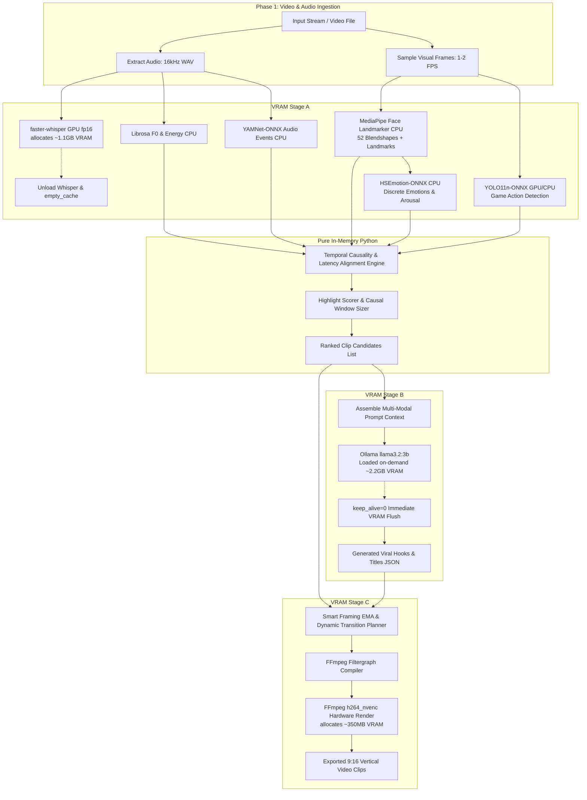

# Architecture Patterns: Streamer Reaction AI Video Clipping System

**Domain:** Automated Multi-Modal Streamer Highlight Extraction & Video Composition  
**Hardware Target:** NVIDIA RTX 3050 Laptop GPU (6GB VRAM), Windows 11, Local Execution  
**Researched:** 2026-11-19  
**Status:** Validated  

---

## Recommended Architecture

The system follows a **Staged Pipeline Architecture** with strict sequential GPU memory scheduling. Rather than running all perception and language models concurrently—which instantly crashes a 6GB VRAM card—the architecture decouples feature extraction, temporal reasoning, LLM inference, and video composition into isolated phases with explicit memory teardown barriers.



---

## Component Boundaries & Responsibilities

| Component | Responsibility | Inputs | Outputs | Execution Runtime |
| :--- | :--- | :--- | :--- | :--- |
| **Ingestion Engine** | Demuxes video, extracts 16kHz mono audio, samples gameplay/facecam frames at 1–2 FPS. | MP4 / MKV / MOV video | Audio WAV buffer, sampled RGB frame array, metadata | FFmpeg + PyAV (CPU) |
| **Speech Transcription Engine** | Performs word-level timestamped transcription. | 16kHz Audio | List of segments with word timestamps and text | `faster-whisper` (GPU fp16, staged) |
| **Facial Emotion Engine** | Detects persistent facecam box, calculates 52 blendshapes (`jawOpen`, `mouthSmile`, `browInnerUp`) and discrete emotion classes. | Sampled frames | Per-second blendshape vectors, emotion logits, face bounding box coordinates | `mediapipe` + `hsemotion-onnx` (CPU / ONNX) |
| **Vocal Arousal Engine** | Extracts pitch ($F_0$), spectral flux, RMS transients, and identifies laughter, shrieks, gasps, gunshots. | 16kHz Audio | Per-second vocal arousal score, event tags (`laughter`, `scream`, `gasp`) | `librosa` + `yamnet.onnx` (CPU) |
| **Gameplay Vision Engine** | Identifies gameplay subjects (vehicles, characters, combat cues, explosions). | Sampled frames | Per-second visual action score, detected object classes | `yolo11n.onnx` (GPU / CPU ONNX) |
| **Temporal Alignment Engine** | Binds in-game action triggers with delayed streamer reaction peaks (300–1200ms lag window) and sets optimal clip boundaries. | Perception signals array | Linked causal event pairs, optimized `[start, end]` clip intervals | Pure Python / NumPy |
| **Viral Hook Engine** | Synthesizes transcript, detected emotion, and gameplay context into viral on-screen headlines and alternative titles. | Clip metadata & causal signals | JSON array of 3 hook alternatives, 3 titles, category | `ollama` (`llama3.2:3b`) via HTTP/SDK |
| **Layout & Video Compiler** | Computes smoothed face crop tracking coordinates (EMA), generates single-pass FFmpeg filtergraphs, burns subtitles, and encodes. | Source video, clip window, tracking tracks, hook text | Final vertical MP4 video (1080x1920) | `ffmpeg` with `h264_nvenc` |

---

## Patterns to Follow

### Pattern 1: Sequential VRAM Staging & Memory Purging

**What:** Never run Whisper, Ollama, and heavy GPU frameworks concurrently on a 6GB VRAM card. Explicitly unload models and trigger garbage collection between execution stages.  
**When:** Throughout the entire pipeline lifecycle.  
**Example Implementation:**

```python
import gc
import torch
import requests
import config

def purge_ollama_vram(model: str = "llama3.2:3b"):
    """Forces Ollama to immediately release VRAM allocations."""
    try:
        requests.post(
            f"{config.OLLAMA_BASE_URL}/api/generate",
            json={"model": model, "prompt": "", "keep_alive": 0},
            timeout=5
        )
    except Exception as err:
        pass

def free_gpu_memory():
    """Flushes PyTorch CUDA caching allocator and triggers system GC."""
    gc.collect()
    if torch.cuda.is_available():
        torch.cuda.empty_cache()
        torch.cuda.ipc_collect()

# Pipeline Execution Sequencing:
# 1. Purge Ollama before running heavy perception models
purge_ollama_vram()
free_gpu_memory()

# 2. Run Whisper on GPU
transcript = transcribe_audio(audio_path, model_size="small", device="cuda")
# Immediately unload Whisper model instance
del transcript_model
free_gpu_memory()

# 3. Run CPU/ONNX perception (0 MB GPU VRAM consumed)
face_metrics = analyze_facecam_mediapipe(frames)
audio_metrics = analyze_vocal_yamnet(audio_path)

# 4. Run Ollama for hooks with keep_alive=0
hooks = generate_hooks_ollama(clip_context, keep_alive=0)
purge_ollama_vram()

# 5. Execute NVENC hardware encoding (now has ~5.5GB free VRAM available)
render_clip_nvenc(filter_graph, output_path)
```

---

### Pattern 2: Streamer Reaction-Gameplay Temporal Causality Alignment

**What:** Human streamers experience a 300ms–1200ms cognitive latency before reacting to in-game surprises. Naive peak windowing cuts off the gameplay event that provoked the reaction. The alignment engine links in-game triggers to reaction peaks and applies asymmetric padding:  
$$T_{\text{start}} = T_{\text{game\_trigger}} - \Delta t_{\text{lead-in}}$$  
$$T_{\text{end}} = T_{\text{reaction\_climax}} + \Delta t_{\text{recovery}}$$

```python
import numpy as np

def align_reaction_to_gameplay(
    gameplay_scores: list[float],
    reaction_scores: list[float],
    lead_in_sec: float = 3.0,
    recovery_sec: float = 4.5,
    max_lag_sec: float = 1.5,
) -> list[dict]:
    """
    Finds causal pairs: a gameplay spike followed within [0.3s, 1.5s] 
    by a streamer reaction spike.
    """
    aligned_clips = []
    duration = min(len(gameplay_scores), len(reaction_scores))
    
    # Identify local peaks in gameplay
    game_thresh = np.percentile(gameplay_scores, 85)
    react_thresh = np.percentile(reaction_scores, 85)
    
    for t_game in range(2, duration - 5):
        if gameplay_scores[t_game] >= game_thresh:
            # Lookahead window for streamer reaction (lag window)
            lookahead_end = min(duration, t_game + int(np.ceil(max_lag_sec)) + 1)
            reaction_window = reaction_scores[t_game : lookahead_end]
            
            if len(reaction_window) > 0 and max(reaction_window) >= react_thresh:
                lag = np.argmax(reaction_window)
                t_reaction = t_game + lag
                
                # Sizing the causal narrative window
                clip_start = max(0.0, float(t_game - lead_in_sec))
                clip_end = min(float(duration), float(t_reaction + recovery_sec))
                
                if clip_end - clip_start >= 12.0:  # Minimum viable short-form clip
                    aligned_clips.append({
                        "start": round(clip_start, 2),
                        "end": round(clip_end, 2),
                        "t_trigger": t_game,
                        "t_reaction": t_reaction,
                        "lag_sec": round(lag, 2),
                        "causal_confidence": float(gameplay_scores[t_game] * 0.5 + reaction_scores[t_reaction] * 0.5),
                    })
    return aligned_clips
```

---

### Pattern 3: Exponential Moving Average (EMA) Bounding Box Tracking

**What:** In vertical split-screen crops, naive bounding box centering produces nauseating micro-jitter whenever the streamer moves their mouth or nods slightly. EMA smoothing with a deadband filters out micro-movements while smoothly panning on real posture shifts.

```python
class SmoothFaceTracker:
    def __init__(self, alpha: float = 0.18, deadband_px: float = 12.0):
        self.alpha = alpha
        self.deadband_px = deadband_px
        self.smooth_cx = None
        self.smooth_cy = None
        self.smooth_w = None
        self.smooth_h = None

    def update(self, raw_box: tuple[float, float, float, float]) -> tuple[int, int, int, int]:
        x, y, w, h = raw_box
        cx, cy = x + w / 2.0, y + h / 2.0

        if self.smooth_cx is None:
            self.smooth_cx, self.smooth_cy = cx, cy
            self.smooth_w, self.smooth_h = w, h
            return int(x), int(y), int(w), int(h)

        # Calculate displacement
        dist = ((cx - self.smooth_cx) ** 2 + (cy - self.smooth_cy) ** 2) ** 0.5

        # Check for rapid saccade (streamer jumped or moved drastically)
        if dist > 150.0:
            # Fast reset to prevent slow sliding across screen
            self.smooth_cx, self.smooth_cy = cx, cy
            self.smooth_w, self.smooth_h = w, h
        elif dist > self.deadband_px:
            # Smooth EMA transition
            self.smooth_cx = self.alpha * cx + (1.0 - self.alpha) * self.smooth_cx
            self.smooth_cy = self.alpha * cy + (1.0 - self.alpha) * self.smooth_cy
            self.smooth_w = self.alpha * w + (1.0 - self.alpha) * self.smooth_w
            self.smooth_h = self.alpha * h + (1.0 - self.alpha) * self.smooth_h

        out_x = int(round(self.smooth_cx - self.smooth_w / 2.0))
        out_y = int(round(self.smooth_cy - self.smooth_h / 2.0))
        return out_x, out_y, int(round(self.smooth_w)), int(round(self.smooth_h))
```

---

### Pattern 4: Single-Pass Dynamic Layout Switching via FFmpeg

**What:** Dynamically switch the screen from full-screen gameplay (pan-and-scan or blurred pillarbox) to 50/50 split-screen reaction mode when the streamer reacts, using FFmpeg's `overlay` timeline `enable` syntax or `xfade` in a single command.

```bash
# Example Single-Pass Filtergraph with Dynamic Split-Screen Transition:
# 1. Base Stream: Full-screen gameplay with blur-fill
# 2. Overlay Stream: Split-screen top facecam and bottom cropped gameplay
# 3. Transitions smoothly when streamer reaction triggers at t=8.5s to t=16.0s

ffmpeg -y -ss 0 -i input.mp4 -t 25.0 -filter_complex "
  [0:v]split=3[full_bg][full_fg][split_src];
  
  # Stream 1: Full gameplay view with blurred background
  [full_bg]scale=1080:1920:force_original_aspect_ratio=increase,crop=1080:1920,boxblur=20:5[bg_full];
  [full_fg]scale=1080:-2[fg_full];
  [bg_full][fg_full]overlay=(W-w)/2:(H-h)/2[layout_full];
  
  # Stream 2: Split-screen top facecam (height 864) and bottom gameplay (height 980)
  [split_src]split=2[face_in][game_in];
  [face_in]crop=480:384:140:60,scale=1080:864:force_original_aspect_ratio=increase,crop=1080:864[face_panel];
  [game_in]delogo=x=140:y=60:w=320:h=240,scale=1080:980:force_original_aspect_ratio=increase,crop=1080:980[game_panel];
  color=c=0x00FFCC:s=1080x8:d=25.0[divider];
  [face_panel][divider][game_panel]vstack=inputs=3[layout_split];
  
  # Dynamic Composite: Show layout_full normally, overlay layout_split during reaction burst (t=8.5 to 16.0)
  [layout_full][layout_split]overlay=0:0:enable='between(t,8.5,16.0)'[v_out]
" -map "[v_out]" -map "0:a:0" -c:v h264_nvenc -b:v 8M -preset p4 output_dynamic.mp4
```

---

## Anti-Patterns to Avoid

| Anti-Pattern | Why It Fails | Recommended Alternative |
| :--- | :--- | :--- |
| **All-Models-Loaded Concurrency** | Loading Whisper, Ollama, PyTorch, and YOLO simultaneously in Python consumes >7.5GB VRAM on initialization, throwing `torch.cuda.OutOfMemoryError` on 6GB cards. | Enforce Phase Barriers: Audio transcription $\rightarrow$ Unload $\rightarrow$ Frame extraction $\rightarrow$ Scoring $\rightarrow$ Ollama with `keep_alive=0` $\rightarrow$ NVENC export. |
| **Symmetrical Reaction-Centered Slicing** | Centering a 30-second clip on the reaction peak ($T \pm 15s$) frequently cuts the in-game cause off at the very beginning or misses the streamer's commentary punchline at the end. | Asymmetrical Causal Sizing: Anchor to $T_{\text{trigger}} - 2.5s$ and extend to $T_{\text{reaction\_climax}} + 4.5s$. |
| **Frame-by-Frame Python Compositing** | Using OpenCV/Pillow in a Python loop to composite 1,800 frames (60s @ 30fps) takes 90–180 seconds, maxes out CPU, and degrades image quality. | Compile the layout logic into a single C-level FFmpeg filtergraph. Hardware NVENC processes the clip in ~5–10 seconds. |
| **Unsmoothed Bounding Box Snapping** | Snapping the crop window to the raw detector bounding box each second makes the facecam wobble constantly as the streamer speaks. | Apply an Exponential Moving Average (EMA) with a 12px deadband and head-and-shoulder room padding. |

---

## Scalability & Hardware Budgeting (RTX 3050 6GB)

```
Total Dedicated VRAM: 6,144 MiB (6.00 GB)
OS & Windows Desktop Window Manager (DWM) baseline: ~800 MiB
Available Working VRAM: ~5,300 MiB
```

### Stage-by-Stage Memory Allocation

| Pipeline Stage | Active GPU Component | Allocated VRAM | Free VRAM Margin | Safety Factor |
| :--- | :--- | :--- | :--- | :--- |
| **Stage 1: Ingestion & Demux** | FFmpeg / PyAV | ~0 MB (CPU) | ~5,300 MiB | 100% |
| **Stage 2: Speech Transcription** | `faster-whisper` (small.en, fp16) | ~1,100 MiB | ~4,200 MiB | Safe (>3.5GB headroom) |
| **Stage 3: Multi-Modal Perception** | MediaPipe (CPU), HSEmotion (CPU), YAMNet (CPU), YOLO11n (ONNX GPU) | ~350 MiB | ~4,950 MiB | Safe (runs mostly on CPU/ONNX) |
| **Stage 4: Highlight Fusion** | Pure Python & NumPy | ~0 MB | ~5,300 MiB | 100% |
| **Stage 5: LLM Hook Generation** | Ollama (`llama3.2:3b`, Q4_K_M) | ~2,250 MiB | ~3,050 MiB | Safe (evicted via `keep_alive=0`) |
| **Stage 6: Video NVENC Render** | FFmpeg `h264_nvenc` + ASS filter | ~380 MiB | ~4,920 MiB | Safe |

---

## Sources

- **NVIDIA Video Codec SDK:** [developer.nvidia.com/video-codec-sdk](https://developer.nvidia.com/video-codec-sdk) (NVENC hardware memory architecture).
- **FFmpeg Filtering Guide:** [ffmpeg.org/ffmpeg-filters.html](https://ffmpeg.org/ffmpeg-filters.html) (Filtergraph expressions and timeline editing).
- **Ollama Architecture & Memory Lifecycle:** [github.com/ollama/ollama](https://github.com/ollama/ollama)
