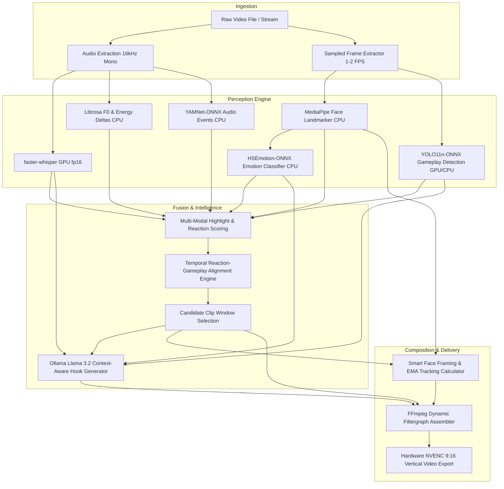

# Feature Landscape: Professional Streamer Reaction Clipping System

**Domain:** Automated Streamer Reaction Clipping & Viral Short-Form Video Creation  
**Researched:** 2026-11-19  
**Status:** Validated  

---

## Table Stakes (Expected Baseline)

Missing these features causes the output to feel amateurish or incomplete when compared to manual video editors or basic tools.

| Feature | Why Expected | Complexity | Implementation Notes |
| :--- | :--- | :--- | :--- |
| **Facecam Isolation & Auto-Detection** | Streamer reaction videos require the creator's face front and center. | Medium | Find edge-anchored streamer camera inset across the full video and crop tightly. |
| **9:16 Vertical Video Layout** | TikTok, YouTube Shorts, and Instagram Reels require portrait orientation (1080x1920). | Low | Stack facecam and gameplay panels or fit widescreen with blurred background fill. |
| **Word-Level Animated Subtitles** | Over 70% of mobile social viewers watch without sound or in noisy environments. | Medium | ASS subtitle generation with karaoke word-level highlighting and pop-in animations. |
| **Audio Loudness Spikes & Dead Air Removal** | Clips must feel punchy without awkward 5-second silences. | Medium | Silence detection via FFmpeg `silencedetect` + transcript gaps with safety padding. |
| **GPU-Accelerated Video Rendering** | Exporting a 30–60 second vertical clip should take <15 seconds, not minutes. | Medium | Hardware NVENC encoding (`h264_nvenc`) with direct FFmpeg filtergraph execution. |

---

## Differentiators (Competitive Edge)

These capabilities transform the software from a generic "cutter" into an intelligent "Streamer Reaction AI Studio" comparable to Opus Clip, Streamladder Pro, or CapCut Pro.

| Feature | Value Proposition | Complexity | Implementation Notes |
| :--- | :--- | :--- | :--- |
| **Reaction-Gameplay Temporal Synchronization** | **Eliminates chopped-off context.** Streamers react with 300ms–1200ms cognitive delay. Syncing reaction spikes with in-game triggers ensures the clip contains the *setup, the action trigger, the reaction delay, the emotional peak, and the recovery punchline*. | High | Temporal cross-correlation and causal windowing: $T_{start} = T_{trigger} - 2.5s$, $T_{end} = T_{reaction\_peak} + 4.0s$. |
| **Multi-Modal Reaction Emotion Scoring** | Replaces brittle motion/smile Haar cascades with actual facial emotion (MediaPipe blendshapes: `jawOpen`, `browInnerUp`, `mouthSmile`) + vocal arousal ($F_0$ pitch jumps, YAMNet laughter/scream detection). | High | Fused score: $\text{Reaction} = 0.35 \times \text{FaceBlendshape} + 0.35 \times \text{VocalArousal} + 0.30 \times \text{AudioEvent}$. |
| **Smart Framing with EMA Jitter Suppression** | Prevents the nauseating "bobblehead" jitter seen in naive face tracking while adapting smoothly to streamer posture shifts. | Medium | Exponential Moving Average (EMA) smoothing ($\alpha = 0.18$) on face coordinates with a 15% velocity deadband and sudden saccade reset. |
| **Dynamic Layout Switching (Adaptive Split)** | Shows full-screen gameplay when the streamer is silent/passive, and dynamically crossfades or slides into split-screen when a high reaction occurs. | High | Single-pass FFmpeg filtergraph using `overlay` with timeline `enable` expressions or `xfade` layout transitions. |
| **Context-Aware Hook Headline & Banner** | Generates click-worthy, viral on-screen headlines (e.g., *"BRO COULD NOT BELIEVE THIS... 💀"*) conditioned on detected emotion + gameplay events + speech transcript. | Medium | Ollama (Llama 3.2 3B) with strict JSON schema and reaction-aware prompt templates; unloads VRAM via `keep_alive=0`. |
| **Visual Polish: Delogo + Blur Fill + Glowing Divider** | Eliminates duplicate streamer facecam in the gameplay panel and replaces ugly black bars with modern blurred game footage and customizable neon divider accents. | Medium | FFmpeg `delogo` mask targeting original inset coordinates + `split` with `boxblur=20:5` + top-down `vstack` with styled graphic dividers. |

---

## Anti-Features (Explicitly Avoid)

| Anti-Feature | Why Avoid | What to Do Instead |
| :--- | :--- | :--- |
| **Monolithic Concurrent Model Loading** | Attempting to hold Whisper, YOLO, Ollama, and PyTorch in 6GB VRAM simultaneously causes immediate CUDA OOM crashes. | Enforce **staged sequential execution** and explicit memory eviction (`keep_alive=0`, `torch.cuda.empty_cache()`). |
| **Frame-by-Frame Python Video Composition** | Using Pillow, OpenCV, or MoviePy to iterate over every video frame in Python is 10x–20x slower, leaks memory, and exhausts CPU cores. | Construct deterministic, single-pass **FFmpeg filtergraphs** executed directly via C-level FFmpeg process. |
| **Symmetrical Windowing Around Reaction Peaks** | Centering a 30s window on the streamer's scream ($T \pm 15s$) places the in-game trigger at the edge or misses the setup entirely. | Use **asymmetrical causal anchoring**: anchor to the *gameplay event trigger*, apply the reaction latency offset, and extend through the reaction recovery. |
| **Over-Aggressive Micro-Dead-Air Cuts** | Cutting every 200ms speech pause destroys the comedic timing, dramatic tension, and natural speech cadence of streamers. | Limit jump cuts to genuine silence intervals (>1.0s), enforce a maximum of 2 cuts per 30s clip, and preserve at least 300ms hesitation padding. |
| **Generative Video / Diffusion Inpainting** | Using Stable Diffusion or GenAI video inpainting for background filling consumes 8GB+ VRAM and takes minutes per frame. | Use high-performance GPU/CPU spatial filters: `delogo` with localized edge blending and `boxblur` canvas fills. |

---

## Feature Dependencies

---

## MVP Recommendation & Roadmap Phasing

### Phase 1: Multi-Modal Reaction Perception (Table Stakes + Core Differentiator)
- **Implement MediaPipe Face Landmarker** with ARKit blendshapes (`jawOpen`, `mouthSmile`, `browInnerUp`).
- **Implement Audio Vocal Arousal Engine** with Librosa $F_0$ pitch tracking and YAMNet-ONNX classification (laughter, screams, gasps).
- **Benchmark:** Verify 0 MB GPU VRAM footprint on CPU inference.

### Phase 2: Reaction-Gameplay Temporal Synchronization
- **Implement Causal Windowing Algorithm:** Link in-game action triggers (YOLO/audio explosions/kills) with subsequent streamer reaction spikes within a 300ms–1500ms cognitive latency window.
- **Implement Asymmetric Anchor Sizing:** Auto-calculate optimal lead-in ($T_{trigger} - 2.5s$) and reaction recovery padding ($T_{reaction} + 4.0s$).

### Phase 3: Smart Framing & Visual Polish
- **Implement EMA Bounding Box Smoothing** with head-shoulder padding for facecam top panel.
- **Implement Advanced Split-Screen Filtergraph:** Facecam top panel + Gameplay delogo + Blurred background fill + Divider bar.
- **Implement Dynamic Layout Transition:** Switch between full-screen gameplay and split-screen when reaction score crosses activation threshold.

### Phase 4: Context-Aware Hook & Subtitle Generation
- **Refactor Ollama Integration:** Provide rich multi-modal prompt containing detected emotion, jaw-drop intensity, transcript, and game event. Enforce strict JSON output and `keep_alive=0` memory flush.
- **Enhanced ASS Subtitle Presets:** Reaction-triggered subtitle styling (e.g., shake/red color for screams, bounce/yellow for laughter).

### Phase 5: Hardware Budgeting & Pipeline Hardening
- **Sequential Execution Controller:** Ensure Whisper, YOLO, Ollama, and FFmpeg NVENC hand off VRAM gracefully on RTX 3050 (6GB).
- **End-to-End Regression & Quality Control:** Verify export times <15s per 30s vertical clip with zero OOM errors.

---

## Sources

- **Opus Clip & CapCut Short-Form UX Benchmarks:** Industry standard 9:16 layout formats and dynamic split-screen paradigms.
- **MediaPipe Blendshape Documentation:** [ai.google.dev/edge/mediapipe/solutions/vision/face_landmarker](https://ai.google.dev/edge/mediapipe/solutions/vision/face_landmarker)
- **YAMNet Audio Event Ontology (Google AudioSet):** [research.google.com/audioset/ontology](https://research.google.com/audioset/ontology)
